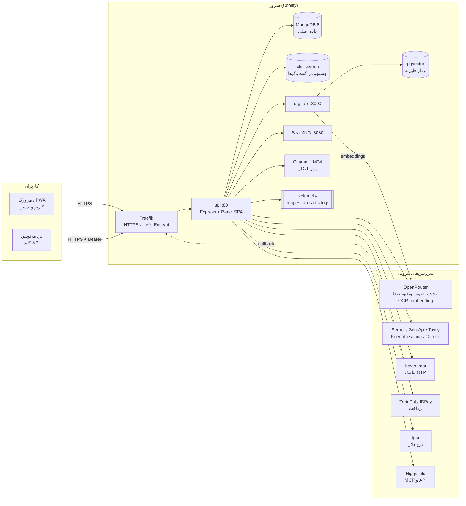
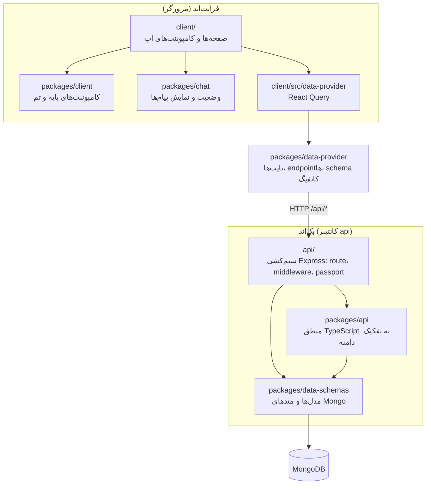
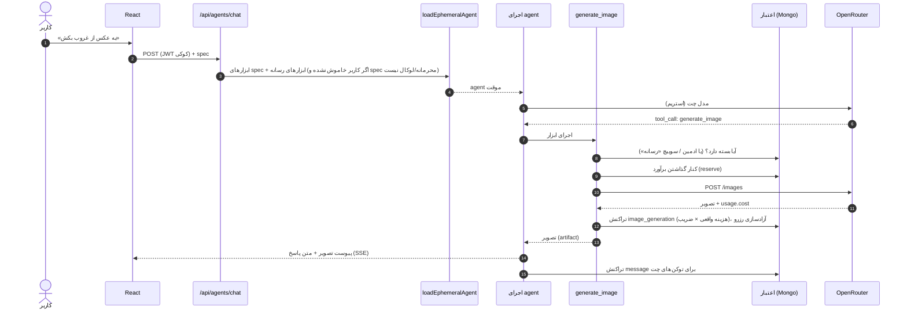
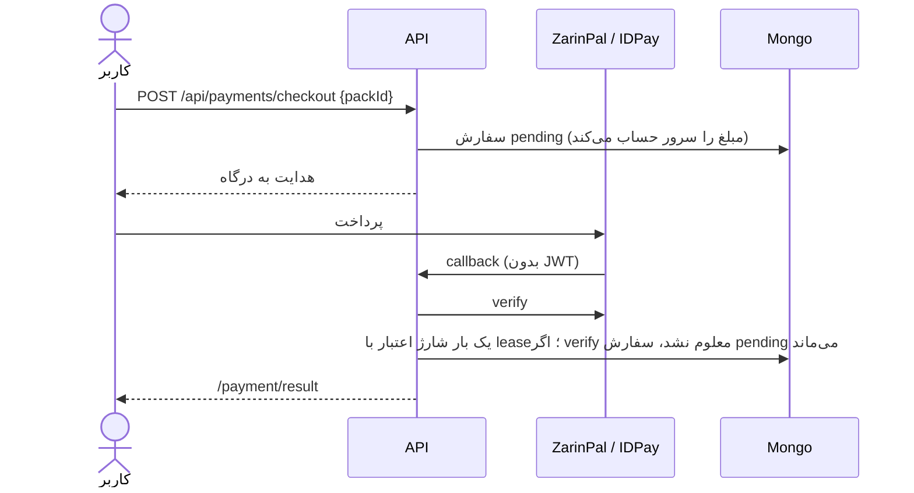
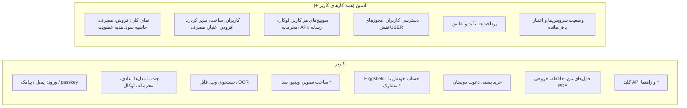
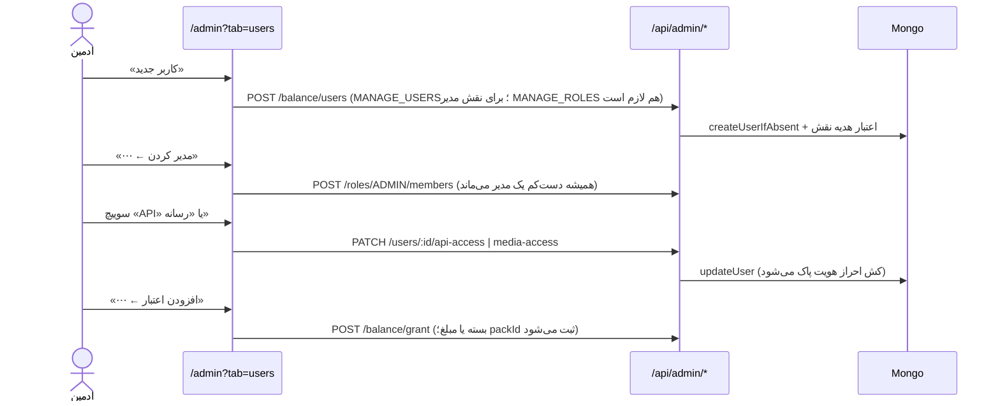

# معماری HiveGPT

این سند سه لایه معماری را توضیح می‌دهد و در پایان، مشکل‌هایی را که در بازبینی پیدا شد فهرست می‌کند:

1. **معماری سیستم**: چه سرویس‌هایی اجرا می‌شوند، کجا و به چه چیزی وصل‌اند.
2. **معماری کاربردی**: کد در چه لایه‌هایی است و یک درخواست از کدام لایه‌ها می‌گذرد.
3. **معماری منطقی کاربر و ادمین**: هر نقش چه کاری می‌تواند بکند و دسترسی با چه قاعده‌ای تعیین می‌شود.

مسیرها نسبت به ریشه مخزن‌اند. نقشه پوشه‌ها در [SOFTWARE_MAP.md](./SOFTWARE_MAP.md)، صورت‌حساب در [BILLING.md](./BILLING.md) و استقرار در [DEPLOY_COOLIFY.md](./DEPLOY_COOLIFY.md) است.

---

## ۱. معماری سیستم

### ۱.۱ نمای کلی

### ۱.۲ کانتینرها (`docker-compose.yml`)

| سرویس | ایمیج | نقش | وابسته به | داده ماندگار |
|---|---|---|---|---|
| `api` | ساخته از `Dockerfile.multi` (Node 24) | سرور Express، کلاینت React، ابزارها، OCR با Tesseract | mongodb (healthy)، meilisearch، rag_api، searxng، ollama | `images`، `uploads`، `logs`، `librechat-data` |
| `mongodb` | `mongo:8.0.20` | کاربران، گفت‌وگوها، پیام‌ها، موجودی، تراکنش‌ها، پرداخت‌ها، فایل‌ها، توکن‌های OAuth | — | `mongodb-data` |
| `meilisearch` | `getmeili/meilisearch:v1.35.1` | جستجوی متن گفت‌وگوها | — | `meili-data` |
| `vectordb` | `pgvector/pgvector:0.8.0-pg15` | بردار تکه‌های فایل | — | `pgvector-data` |
| `rag_api` | `librechat-rag-api-dev-lite:latest` | تکه‌کردن فایل، embedding و جستجوی برداری | vectordb | `rag-uploads` |
| `searxng` | ساخته از `deploy/searxng` | آخرین حلقه زنجیره جستجوی وب | — | — |
| `ollama` | `ollama/ollama:latest` | مدل لوکال (`hivegpt-local`) و مدل لوکال بی‌سانسور | — | `ollama-models` |

- فقط `api` دامنه عمومی دارد و بقیه در شبکه داخلی stack هستند.
- Traefik در Coolify گواهی HTTPS را می‌گیرد. `TRUST_PROXY=1` است.
- Redis در stack نیست. حالت فعلی برای **یک** نمونه `api` درست است (جزئیات در بخش ۴).

### ۱.۳ سرویس‌های بیرونی و جای تنظیمشان

| سرویس | کاربرد | تنظیم |
|---|---|---|
| OpenRouter | همه مدل‌های ابری، و endpoint محرمانه `OpenRouterPrivate` (بدون نگه‌داری داده) | `endpoints.custom`، `OPENROUTER_KEY` |
| OpenRouter Image / Video / Speech | ساخت تصویر، ویدیو و صدا در چت | `mediaGeneration` |
| OpenRouter vision و Tesseract | OCR فایل‌های اسکن‌شده | `documentOcr` |
| OpenRouter audio | صدا به متن و خواندن پیام | `speech` |
| Serper → SerpApi → Tavily → SearXNG | جستجوی وب با جایگزین خودکار | `webSearch.providerChain` |
| Keenable، Jina یا Cohere | خواندن صفحه‌ها و رتبه‌بندی نتیجه‌ها | `webSearch` |
| Kavenegar | ورود با کد پیامکی | `KAVENEGAR_API_KEY`، `KAVENEGAR_TEMPLATE` |
| ZarinPal و IDPay | خرید بسته | `payments.gateways` |
| tgju | نرخ دلار بازار آزاد برای قیمت تومانی | `interface.currency` |
| Higgsfield MCP | ساخت تصویر و ویدیو با حساب Higgsfield (شخصی یا مشترک) | `mcpServers.higgsfield` |
| Higgsfield API | همان کار با کلید سرور، از اعتبار HiveGPT | `mediaGeneration.higgsfield` |

---

## ۲. معماری کاربردی

### ۲.۱ لایه‌ها

قاعده (`AGENTS.md`): منطق جدید در `packages/api` نوشته می‌شود. `api/` فقط route ثبت می‌کند و ماژول‌ها را صدا می‌زند. وابستگی‌ها (دیتابیس، کانفیگ، کلاینت سرویس‌ها) از بیرون به ماژول داده می‌شوند.

### ۲.۲ دامنه‌های بک‌اند

| دامنه | مسیر | کار |
|---|---|---|
| احراز هویت | `api/strategies`، `packages/api/src/auth` | ایمیل و رمز، OTP پیامکی، passkey، 2FA، OpenID (اختیاری)، JWT و refresh |
| دسترسی | `packages/api/src/middleware/capabilities.ts`، `admin/access.ts`، `app/service.ts` | نقش، مجوزهای نقش، capabilityهای ادمین، استثناهای هر کاربر |
| چت و agent | `api/server/controllers/agents`، `packages/api/src/agents` | ساختن agent موقت از model spec، اجرای مدل، استریم و ذخیره پیام |
| ابزارها | `api/server/services/ToolService.js`، `packages/api/src/tools`، `packages/api/src/media`، `packages/api/src/mcp` | جستجوی وب، جستجو در فایل‌ها، حافظه، تصویر، ویدیو و صدا، MCP (Higgsfield) |
| فایل و RAG | `api/server/services/Files`، `packages/api/src/files` | بارگذاری، OCR، ارسال به rag_api، فایل‌های من |
| صورت‌حساب | `packages/api/src/billing`، `payments`، `referral` | اعتبار، بسته‌ها، پرداخت، دعوت، قیمت تومانی |
| API برنامه‌نویسی | `packages/api/src/apiKeys`، `api/server/routes/agents/{openai,responses}.js` | کلید API، مسیرهای سازگار با OpenAI، نام model spec به‌جای شناسه agent |
| ادمین | `api/server/routes/admin/*`، `client/src/components/Billing` | نمای کلی، کاربران و اعتبار، دسترسی‌ها، پرداخت‌ها، وضعیت سرویس‌ها |

### ۲.۳ مسیر یک پیام چت (با ساخت تصویر)

ویدیو و صدا همین مسیر را می‌روند. فرقشان این است که ابزار فایل را خودش در `/images/{userId}/…` ذخیره می‌کند و لینکی برمی‌گرداند که در چت پخش می‌شود. ساخت ناموفق هیچ هزینه‌ای ندارد.

### ۲.۴ مسیر پرداخت

### ۲.۵ داده‌های اصلی (MongoDB)

| گروه | collectionها |
|---|---|
| هویت | `user`، `session`، `token` (OAuth MCP، تأیید)، `passkey`، `role`، `group`، `aclEntry`، `accessRole`، `systemGrant` |
| گفت‌وگو | `convo`، `message`، `share`، `conversationTag`، `memory`، `preset` |
| فایل | `file`، `codeEnvRef`، و بردارها در pgvector |
| پول | `balance` (اعتبار، `packId`)، `transaction` (همه شارژها و کسرها با `context`)، `payment` |
| agent و API | `agent`، `agentApiKey` (فقط hash و پیشوند کلید)، `mcpServer`، `toolCall`، `schedule` |
| مدیریت | `config` (تنظیمات DB)، `auditLog`، `banner` |

---

## ۳. معماری منطقی کاربر و ادمین

### ۳.۱ چه کسی چه کاری می‌کند

`*` یعنی این امکان به قاعده دسترسی بخش ۳.۲ بستگی دارد.

### ۳.۲ لایه‌های دسترسی

هر درخواست به ترتیب از این دروازه‌ها می‌گذرد:

| # | دروازه | کجا | چه چیزی را می‌سنجد |
|---|---|---|---|
| 1 | احراز هویت | `requireJwtAuth`، `jwtStrategy` (یا کلید API) | کاربر کیست. سند کاربر کامل بارگذاری می‌شود و `apiAccess`، `mediaAccess` و `modelAccess` را دارد |
| 2 | مسدودی | `checkBan` | کاربر یا IP مسدود است یا نه |
| 3 | capability ادمین | `requireCapability(ACCESS_ADMIN / READ_USERS / MANAGE_USERS / MANAGE_ROLES)` | فقط برای `/api/admin/*` |
| 4 | مجوز نقش | `generateCheckAccess(PermissionTypes.X)` | امکاناتی مثل جستجوی وب، حافظه، MCP و API برای نقش USER |
| 5 | استثنای هر کاربر | فیلدهای سند کاربر | اگر مقدار داشته باشد بر نقش غلبه می‌کند (جدول بعدی) |
| 6 | قاعده محصول | کد دامنه | مثلاً رسانه فقط برای کسی که بسته دارد، و API فقط با اعتبار بیشتر از صفر |

اولویت استثناهای هر کاربر:

| امکان | فیلد کاربر | اگر خالی باشد | ادمین |
|---|---|---|---|
| مدل لوکال و محرمانه | `modelAccess.local/private` | مجوز نقش | همیشه دارد |
| API برنامه‌نویسی | `apiAccess` | مجوز نقش `REMOTE_AGENTS` | نقش ادمین آن را دارد |
| ساخت رسانه | `mediaAccess` | `paidOnly`: بسته (`balance.packId`) لازم است | همیشه دارد |
| Higgsfield مشترک | `mediaAccess` | `sharedOAuth.allow` (پیش‌فرض: کسانی که بسته دارند) | همیشه دارد |

در همه موارد `true` یعنی همیشه مجاز، `false` یعنی هرگز، و خالی یعنی قاعده پیش‌فرض. چت‌های محرمانه و لوکال هیچ‌وقت ابزار رسانه و MCP نمی‌گیرند.

### ۳.۳ کارهای اصلی ادمین

---

## ۴. نتیجه بازبینی (دیباگ)

| شدت | مشکل | اثر | وضعیت / پیشنهاد |
|---|---|---|---|
| بالا | API برنامه‌نویسی ابزارهای تصویر، ویدیو و صدا را می‌گرفت | هزینه از کاربر API کم می‌شد، ولی فایل به چت می‌رفت و لینکش پشت کوکی نشست بود. برنامه‌نویس عملاً چیزی دریافت نمی‌کرد | **رفع شد** در همین PR: ابزارهای رسانه از agent مسیر API حذف می‌شوند (`apiKeys/models.ts` با تست) |
| متوسط | Redis در stack نیست | جریان‌های OAuth، محدودیت نرخ، کش‌ها و lease پرداخت در حافظه همان یک پروسه‌اند. با دو نمونه `api` به هم می‌ریزند | تا وقتی فقط یک نمونه هست مشکلی نیست. پیش از افزایش نمونه‌ها، Redis و `USE_REDIS=true` لازم است |
| متوسط | ایمیج‌های `ollama:latest`، `searxng:latest` و `rag-api-dev-lite:latest` نسخه ثابت ندارند | یک redeploy ممکن است نسخه ناسازگار بیاورد | نسخه را ثابت کنید، مثل mongo و meilisearch |
| متوسط | پشتیبان‌گیری خودکار از `mongodb-data` و `pgvector-data` تعریف نشده | با خراب شدن دیسک، پول و تاریخچه کاربران از دست می‌رود | backup زمان‌بندی‌شده Coolify یا `mongodump` روزانه |
| متوسط | ساخت ویدیو تا ۱۵ دقیقه در همان درخواست چت منتظر می‌ماند | با قطع اتصال، ویدیو ساخته و هزینه‌اش کم می‌شد ولی در پیام دیده نمی‌شد | **رفع شد** (۰٫۲۵٫۰): ویدیو کار پس‌زمینه است (`MediaJob` + worker)، چت کارت «در حال ساخت» نشان می‌دهد و هزینه فقط هنگام تحویل کم می‌شود |
| کم | CSP پیش‌فرض report-only است | سیاست امنیتی مرورگر فقط گزارش می‌شود و اجرا نمی‌شود | بعد از بررسی گزارش‌ها `CSP_REPORT_ONLY=false` |
| کم | `ollama` تا ۳۲ گیگ RAM و ۱۲ هسته می‌گیرد و مدل بی‌سانسور ۳۵B است | روی سرور کوچک، `api` و Mongo کم می‌آورند | `LOCAL_MODEL_UNCENSORED=none` یا سرور جدا برای Ollama |
| کم | `SOFTWARE_MAP.md` پورت `api` را 3080 نوشته بود و Ollama را نداشت | سند گمراه‌کننده | **رفع شد**: پورت 80 و Ollama |
| اطلاع | اتصال Higgsfield مشترک با شرایط استفاده Higgsfield (اشتراک حساب) سازگار نیست | خطر بسته شدن حساب برای همه | تصمیم مالک پروژه است. راه رسمی، Higgsfield API است |

بررسی‌هایی که مشکلی پیدا نکردند:

- **فیلدهای کاربر در `req.user`:** `jwtStrategy` سند کاربر را با projection حذفی بارگذاری می‌کند، پس `apiAccess` و `mediaAccess` در آن هستند. کش OpenID هم با `updateUser` پاک می‌شود.
- **پخش فایل‌های رسانه:** فایل‌ها با `express.static` و MIME درست (`video/mp4`، `audio/wav`) و پشتیبانی Range پخش می‌شوند. الگوی `/images/{userId}/…` محدودیت پسوند ندارد.
- **CSP برای پخش:** CSP پخش از مبدأ خود سایت را اجازه می‌دهد (`media-src 'self'`).
- **ابزارها در مسیر API:** تابع ذخیره artifact (`createToolEndCallback`) در مسیر API هم اجرا می‌شود.
