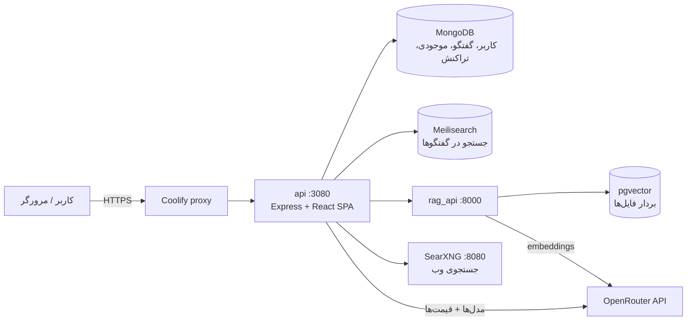

# نقشه نرم‌افزار

این سند نشان می‌دهد هر بخش از پروژه کجاست و یک درخواست چت از کدام لایه‌ها عبور می‌کند. مسیرها نسبت به ریشه مخزن هستند.

## نمای کلی

همه سرویس‌ها در `docker-compose.yml` تعریف شده‌اند. فقط `api` دامنه عمومی دارد و بقیه داخل شبکه خصوصی stack هستند.

## پوشه‌ها

| مسیر | نقش |
|---|---|
| `api/` | سرور Express (CommonJS). فقط سیم‌کشی: route، middleware و فراخوانی ماژول‌های TS. ورودی: `api/server/index.js` |
| `api/server/routes/` | تعریف routeها. چت: `agents/chat.js`. موجودی کاربر: `balance.js`. ادمین: `admin/*.js` |
| `api/server/controllers/` | کنترلرها. چت اصلی: `agents/request.js` و `agents/client.js` |
| `api/server/services/` | سرویس‌های قدیمی: فایل‌ها (`Files/`)، کانفیگ (`Config/`)، MCP |
| `api/strategies/` | احراز هویت با passport: local، JWT، OpenID، LDAP و social |
| `packages/api/src/` | **منطق اصلی بک‌اند (TypeScript)**. کد جدید اینجا نوشته می‌شود |
| `packages/data-schemas/src/` | مدل‌ها و متدهای MongoDB: `schema/`، `methods/`، `types/` |
| `packages/data-provider/src/` | تایپ‌ها و schema مشترک کلاینت و سرور. schema کامل `librechat.yaml` در `config.ts` است |
| `packages/client/`، `packages/chat/` | کامپوننت‌های UI مشترک و بسته چت |
| `client/src/` | اپ React. `components/`، `hooks/`، `data-provider/` (react-query)، `locales/` (ترجمه‌ها) |
| `config/` | اسکریپت‌های CLI ادمین (`create-user`، `add-balance`، **`grant-pack`**) و **`librechat.saas.yaml`** |
| `deploy/searxng/` | تنظیمات SearXNG |
| `helm/` | چارت Kubernetes (upstream؛ در این fork استفاده نمی‌شود) |
| `e2e/` | تست‌های Playwright |
| `docs/saas/` | مستندات همین fork |

## داخل `packages/api/src`

| پوشه | چه چیزی |
|---|---|
| `agents/` | اجرای مدل (LangGraph)، ابزارها و ثبت مصرف: `usage.ts` → `spendTokens` |
| `endpoints/custom/` | اتصال به endpointهای سفارشی مثل OpenRouter. قیمت هر مدل در `initialize.ts` تعیین می‌شود |
| `endpoints/models.ts` | دریافت لیست مدل‌ها و قیمت‌ها از `GET {baseURL}/models` |
| `utils/tokens.ts` | `processModelData`: تبدیل قیمت دلاری OpenRouter به نرخ داخلی |
| **`billing/`** | **افزوده این fork**: ضریب قیمت (`markup.ts`)، بسته‌ها (`packs.ts`)، API ادمین (`handlers.ts`) |
| `middleware/checkBalance.ts` | رزرو اعتبار قبل از هر درخواست |
| `web/` | جستجوی وب (SearXNG، Keenable، Firecrawl و ...) |
| `files/` | آپلود، RAG (`rag.ts`) و OCR |
| `mcp/` | Model Context Protocol |
| `app/loader.ts` | بارگذاری `librechat.yaml` از `CONFIG_PATH` (مسیر فایل یا URL) |
| `admin/` | API پنل ادمین (کانفیگ، کاربران، نقش‌ها) |

## مسیر یک پیام چت

1. **کلاینت:** `client/src/components/Chat/Input/ChatForm.tsx` پیام را به `POST /api/agents/chat/OpenRouter` می‌فرستد و پاسخ را با SSE از `GET /api/agents/chat/stream/:id` می‌خواند (`client/src/hooks/SSE/`).
2. **Route:** `api/server/routes/agents/chat.js` ابتدا احراز هویت، moderation و دسترسی را بررسی می‌کند و بعد `AgentController` را صدا می‌زند.
3. **آماده‌سازی مدل:** `initializeCustom` در `packages/api/src/endpoints/custom/initialize.ts`:
   - قیمت مدل‌های OpenRouter را از cache می‌خواند یا از `/models` دریافت می‌کند.
   - **ضریب `priceMultiplier` را اعمال می‌کند.**
   - نتیجه `endpointTokenConfig` است.
4. **بررسی موجودی:** `checkBalance` تخمین هزینه را از موجودی رزرو می‌کند. اگر موجودی کافی نباشد، پیام «اعتبار کافی نیست» نمایش داده می‌شود.
5. **اجرا:** `api/server/controllers/agents/client.js` مدل را اجرا می‌کند. در صورت نیاز ابزار `web_search` (SearXNG) یا `file_search` (rag_api) را فراخوانی می‌کند و پاسخ را stream می‌کند.
6. **کسر اعتبار:** `recordCollectedUsage` → `spendTokens` (`packages/data-schemas/src/methods/spendTokens.ts`) → `createTransaction`. نتیجه یک تراکنش منفی و کاهش `tokenCredits` در Balance است.
7. **ذخیره:** پیام در MongoDB ذخیره و در Meilisearch ایندکس می‌شود. کلاینت موجودی را دوباره می‌خواند و نوار مصرف به‌روز می‌شود.

## داده‌های مالی در MongoDB

- **`balances`:** برای هر کاربر یک رکورد با این فیلدها:
  - `tokenCredits`: موجودی فعلی
  - `packId` و `packLabel`: آخرین بسته‌ای که به کاربر داده شده
  - `packAllotment`: موجودی کاربر درست بعد از دریافت بسته (مبنای درصد مصرف)
  - `packGrantedAt`: زمان دریافت بسته
- **`transactions`:** دفتر کل. هر مصرف یک رکورد منفی دارد و هر شارژ یک رکورد مثبت با `context: pack` یا `admin`.

جزئیات قیمت‌گذاری در [BILLING.md](./BILLING.md) آمده است.

## تغییرات این fork نسبت به LibreChat اصلی

| فایل | تغییر |
|---|---|
| `packages/api/src/billing/*` | ماژول جدید: ضریب قیمت، بسته‌ها و API ادمین |
| `packages/api/src/utils/tokens.ts` | خواندن قیمت cache از OpenRouter، و رد کردن مدل‌هایی که قیمتشان `-1` است |
| `packages/api/src/endpoints/custom/initialize.ts`، `endpoints/tokenConfig.ts` | اعمال `priceMultiplier` |
| `packages/data-provider/src/config.ts` | فیلدهای `endpoints.custom[].priceMultiplier` و `balance.packs` |
| `packages/data-schemas/src/schema/balance.ts` | فیلدهای `pack*` |
| `api/server/routes/admin/balance.js` | مسیرهای `/api/admin/balance/*` |
| `config/grant-pack.js` | CLI دادن بسته به کاربر |
| `client/src/utils/balance.ts`، `components/Balance/Summary.tsx`، `components/Nav/AccountSettings.tsx` | نوار مصرف بر اساس بسته و نمایش آن در منوی حساب |
| `config/librechat.saas.yaml`، `docker-compose.yml`، `deploy/` | پیکربندی و استقرار |
| `.github/workflows/` | حذف شد (CI فقط محلی) |
